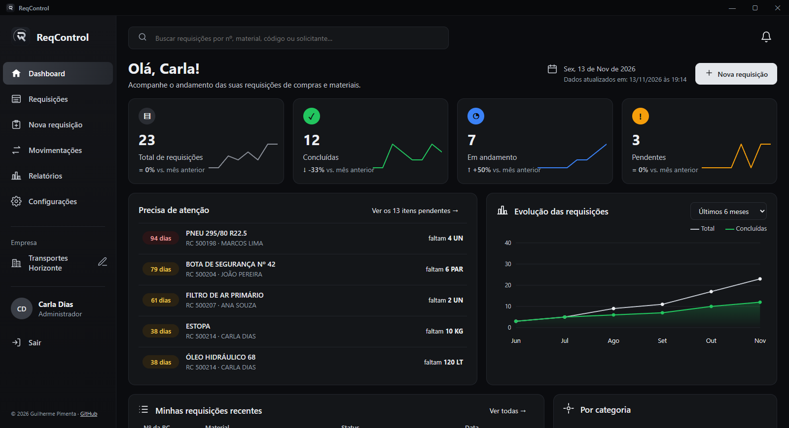
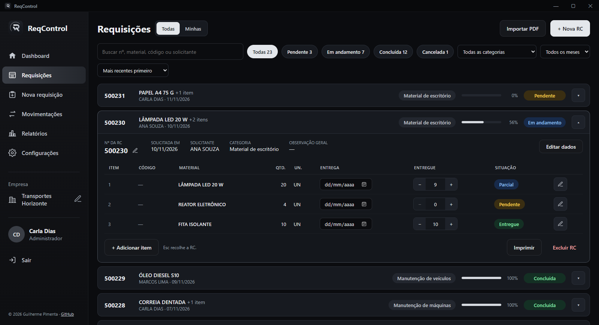
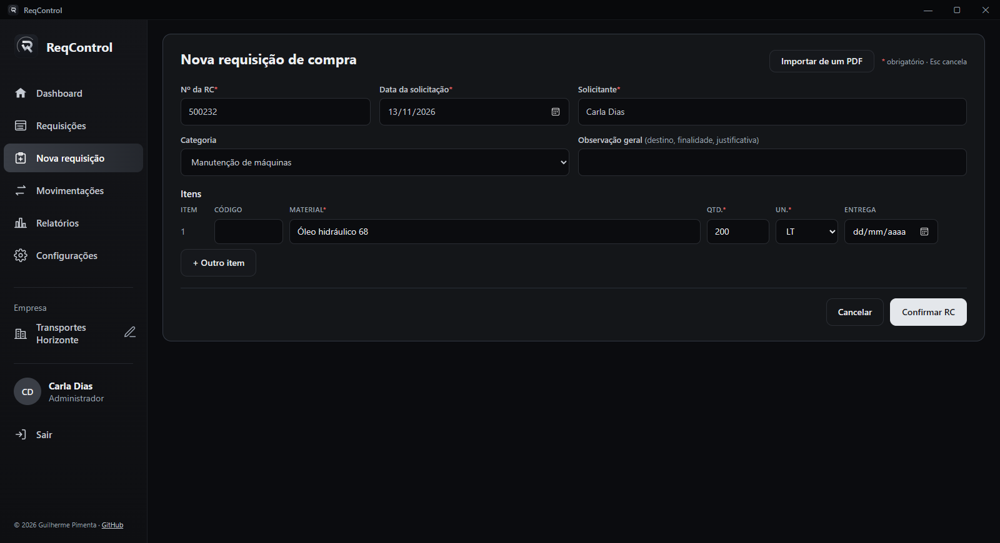
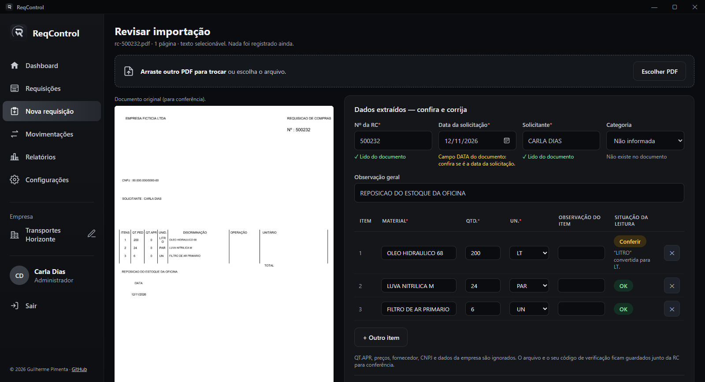
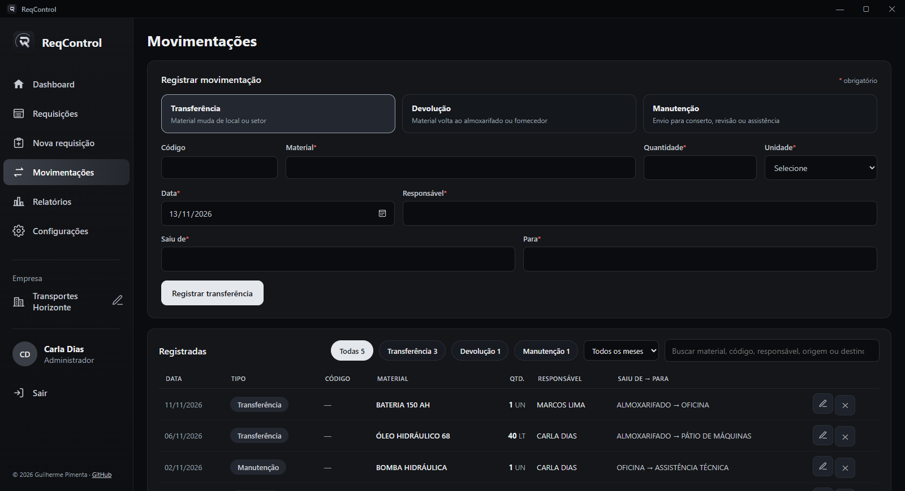
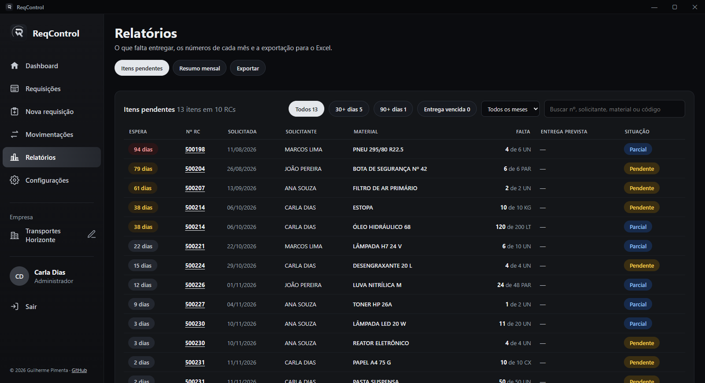
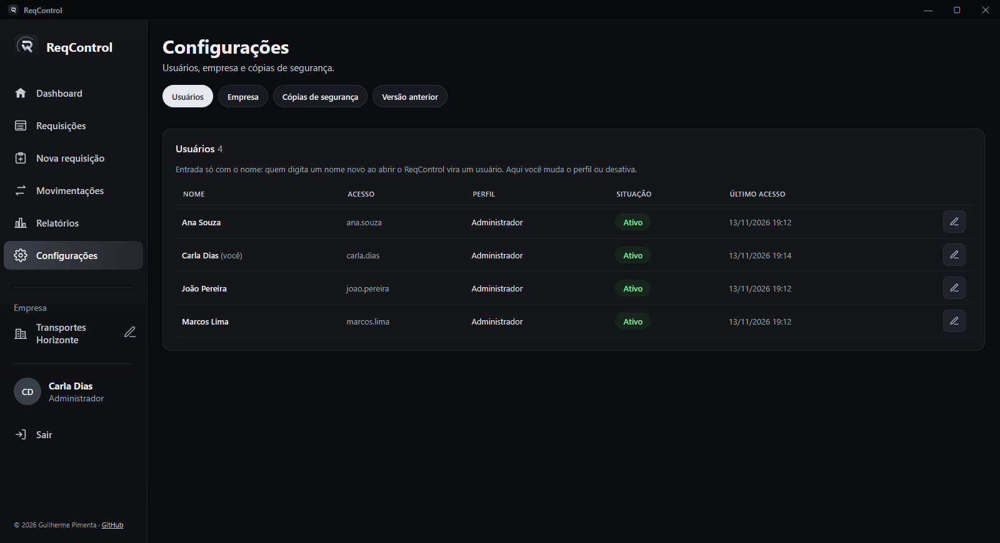

<div align="center">


# ReqControl

**Requisições de compra, entregas por item e movimentações de materiais, num só lugar.**<br>
Aplicativo para Windows que funciona **100% offline**, com os dados guardados no próprio computador.

[](https://github.com/Gui0ffx/ReqControl/releases/latest)


<br>

<a href="https://github.com/Gui0ffx/ReqControl/releases/latest">
  
</a>

<sub>Instalador, sem precisar de administrador. Já usa a 1.2.6? As suas RCs são importadas na primeira abertura.</sub>

<br><br>



</div>

> [!TIP]
> **Já usa a versão 1.2.6?** A 2.0 usa a mesma pasta de dados e, na primeira abertura, oferece **importar as suas RCs,
> itens e movimentações**. Os arquivos da 1.2.6 não são alterados.

---

## ✨ O que há de novo na 2.0

<table>
<tr>
<td width="50%" valign="top">

### 🔐 Usuários e perfis
Cada pessoa entra com o próprio usuário. **Administrador**, **Operador** ou **Somente leitura**, com a permissão
conferida no próprio sistema, não só escondendo botões.

### 📦 Entrega por item
Cada item tem a **sua** data de entrega. Lance o que chegou com **− / +** e veja a situação de cada item:
Pendente, Parcial, Entregue ou Cancelado.

### 🧾 Importar RC de PDF
Arraste o PDF da requisição: o ReqControl lê nº, data, solicitante e itens e mostra tudo **ao lado do documento
original para você conferir** antes de gravar. Nada é registrado sem a sua confirmação.

### 🔎 Catálogo de materiais
Digite o código ou o nome e escolha com <kbd>Tab</kbd>. Código que não existe no catálogo é recusado.

</td>
<td width="50%" valign="top">

### 📊 Dashboard e relatórios
Totais por status, evolução mês a mês, categorias, **itens pendentes por tempo de espera**, **filtro de mês** nas buscas (amarelo a partir de 30 dias,
vermelho a partir de 90) e resumo mensal. Exportação **CSV** para o Excel.

### 🖨️ Impressão A4
A RC em PDF A4, pronta para imprimir ou salvar.

### 💾 Cópias de segurança automáticas
Uma por dia (14 dias), uma antes de cada exclusão (30 últimas) e cópia manual quando quiser.

### 🔄 Atualiza sozinho
Ao abrir, confere se saiu uma versão nova e, se saiu, **baixa e confere (SHA256) em segundo plano**, sem aviso. Quando
fica pronta, pergunta **"Reiniciar agora?"**: com o sim, instala **sem nenhuma janela de instalação** e abre de novo já
atualizado; com **Agora não**, nada acontece e o **sino** guarda a atualização para quando você quiser. Depois de
atualizar, a janela **Novidades** mostra o que foi adicionado ou alterado. *(Atualização automática desde a 2.0.4;
silenciosa desde a 2.0.6.)*

### 🔁 Traz os dados da 1.2.6
Na primeira abertura, as RCs, itens, movimentações e o histórico da 1.2.6 são importados, com conferência e relatório.

### 🌑 Visual novo
Tema escuro, tela cheia e barra de título própria. Tudo em português.

</td>
</tr>
</table>

## 🖼️ Telas

<table>
<tr>
<td align="center"><br><sub><b>Requisições</b>: o material na lista e a RC aberta com itens, entrega e situação</sub></td>
<td align="center"><br><sub><b>Nova RC</b>: campos obrigatórios com asterisco</sub></td>
</tr>
<tr>
<td align="center"><br><sub><b>Importar PDF</b>: revisão obrigatória ao lado do original</sub></td>
<td align="center"><br><sub><b>Movimentações</b>: "Saiu de" e "Para"</sub></td>
</tr>
<tr>
<td align="center"><br><sub><b>Relatórios</b>: o que falta entregar, do mais antigo</sub></td>
<td align="center"><br><sub><b>Configurações</b>: usuários, empresa e cópias</sub></td>
</tr>
</table>

<sub>As telas usam dados fictícios.</sub>

## ⬇️ Instalação

Na [**página de downloads**](https://github.com/Gui0ffx/ReqControl/releases/latest), baixe o instalador:

- **`ReqControl-Instalador-2.0.7.exe`**: instala para o seu usuário (sem pedir administrador), com atalho no menu
  Iniciar, opção de atalho na área de trabalho e desinstalador. Traz também o `ReqControl-Ferramentas.exe`.
  Se a **1.2.6** ("Controle de RCs") estiver instalada, ela é **substituída** (as suas RCs ficam e são importadas).

Na primeira vez, o Windows pode mostrar *"O Windows protegeu o computador"*, porque o arquivo não é assinado. Clique em
**Mais informações → Executar assim mesmo**. Para conferir se o arquivo é o original, compare o hash com o
`SHA256.txt` da mesma Release.

Na primeira abertura:
1. informe o **nome da empresa** e o **seu nome** (por enquanto não há senha: ao abrir, o ReqControl pergunta
   *"Quem está usando?"* e quem já usou entra com um clique);
2. se a **1.2.6** já foi usada neste computador, aparece *"Importar os dados da versão anterior?"* com quantas RCs,
   itens e movimentações serão trazidos. Se algum item estiver sem unidade, escolha a unidade ali mesmo e clique em
   **Importar agora** (ou importe depois em **Configurações → Versão anterior**).

Requisitos: Windows 10 ou 11 com o **Microsoft Edge WebView2** (já vem no Windows 11 e nas versões atualizadas do
Windows 10).

## 💾 Seus dados

Tudo fica em `%LOCALAPPDATA%\ControleRC` — **a mesma pasta da 1.2.6** —, fora da pasta do programa (trocar de versão
não mexe nos dados):

```text
reqcontrol.db                      banco do ReqControl 2 (RCs, itens, movimentações, usuários e histórico)
backups-v2\diario\AAAA-MM-DD\      cópia diária automática (14 dias)
backups-v2\eventos\...              cópia antes de excluir, importar, atualizar ou restaurar (30 últimas) e manuais
importacoes\                       PDFs importados, guardados junto da RC
logs
eqcontrol.log                log técnico, sem o conteúdo das RCs
relatorio-importacao-1.2.6-*.txt   relatório da importação dos dados da 1.2.6
data\, backups\                    arquivos da 1.2.6: só lidos, nunca alterados
```

> [!NOTE]
> Depois de importar, a 1.2.6 continua abrindo os dados antigos, mas o que você lançar na 2.0 fica só na 2.0.
> Use uma versão de cada vez.

Na versão instalada vem junto o **`ReqControl-Ferramentas.exe`** (na pasta `%LOCALAPPDATA%\Programs\ReqControl`),
para usar no Prompt de Comando com o ReqControl fechado:

| Comando | Para quê |
|---|---|
| `ReqControl-Ferramentas copias` | lista as cópias de segurança |
| `ReqControl-Ferramentas restaurar diario/2026-11-11` | volta para uma cópia (o estado atual é guardado antes) |
| `ReqControl-Ferramentas recuperar-admin` | senha provisória para um administrador que esqueceu a senha |

## 🔒 Segurança e privacidade

- **Offline:** o serviço do aplicativo só aceita conexões do próprio computador (127.0.0.1), numa porta aleatória e com
  um código novo a cada abertura. Sem telemetria.
- **Atualizações:** ao abrir, o ReqControl só **lê** a página pública da última versão no GitHub (nenhum dado seu é
  enviado; sem internet, não avisa nada). Só baixa arquivos das Releases deste repositório e só instala se o SHA256
  conferir com o `SHA256.txt` da mesma Release. Nada é instalado sem você clicar em **Atualizar agora**.
- **Usuários:** por enquanto a entrada é **só com o nome**, sem senha (o login com senha está pronto no código e
  pode voltar). Quando ativado: senhas guardadas só como hash, bloqueio após tentativas erradas e sessão que expira.
  As permissões são conferidas em cada ação.
- **Entrada validada:** todos os dados são validados no servidor; o CSV é protegido contra injeção de fórmula.
- **Cópias antes de excluir:** toda exclusão é precedida de uma cópia de segurança do banco.
- **Sem criptografia própria:** o banco fica legível para o seu usuário do Windows. Use BitLocker e uma conta com senha
  se isso for um risco.

## 🧪 Limitações conhecidas

- PDF escaneado (imagem) ainda não é lido automaticamente: os dados podem ser digitados na própria tela de revisão.
- O `.exe` não é assinado digitalmente (aviso do SmartScreen na primeira vez).
- A janela não maximizada não é redimensionada pelas bordas (o aplicativo abre em tela cheia).

## ❓ Dúvidas frequentes

<details>
<summary><b>O app começou vazio. Cadê as minhas RCs?</b></summary>

Se a 1.2.6 foi usada neste computador, entre com um usuário **administrador**: aparece o aviso para importar. Se você escolheu
"Agora não", importe em **Configurações → Versão anterior**. A importação só é feita com o ReqControl 2 ainda sem RCs,
para não misturar dados. Num computador novo, sem a 1.2.6, o app começa vazio mesmo: é só cadastrar.
</details>

<details>
<summary><b>Esqueci a minha senha.</b></summary>

Na versão atual não há senha: é só informar o nome. Quando o login com senha estiver ativado, peça a um administrador: em **Configurações → Usuários → Redefinir senha** ele cria uma senha provisória. Se o único
administrador esqueceu a senha, use `ReqControl-Ferramentas recuperar-admin` no próprio computador.
</details>

<details>
<summary><b>Preciso de internet?</b></summary>

Não. Tudo funciona no próprio computador.
</details>

<details>
<summary><b>Como imprimo uma RC?</b></summary>

Abra a RC e clique em **Imprimir**: o PDF A4 abre no visualizador de PDF do Windows, de onde você imprime ou salva.
</details>

## 🛠️ Feito com

Python (FastAPI, SQLAlchemy, Alembic, Pydantic) · SQLite · React + TypeScript · pywebview + WebView2 · PyInstaller.
151 testes do sistema e 41 testes de tela, todos com dados fictícios.

## 📜 Versões

| Versão | Situação |
|---|---|
| [2.0.7](https://github.com/Gui0ffx/ReqControl/releases/tag/v2.0.7) | **atual**: importação de RCs com várias páginas (todos os itens, sem rodapé misturado, data certa) |
| [2.0.6](https://github.com/Gui0ffx/ReqControl/releases/tag/v2.0.6) | painel com "Precisa de atenção", cores de status consistentes, material na lista e atualização silenciosa |
| [2.0.5](https://github.com/Gui0ffx/ReqControl/releases/tag/v2.0.5) | corrige a quantidade dos itens ao importar PDF e a categoria na edição; sem versão portátil |
| [2.0.4](https://github.com/Gui0ffx/ReqControl/releases/tag/v2.0.4) | atualização automática com 1 clique e janela de novidades da versão |
| [2.0.3](https://github.com/Gui0ffx/ReqControl/releases/tag/v2.0.3) | entrada só com o nome, substitui a 1.2.6 ao instalar, tela de carregamento |
| [2.0.2](https://github.com/Gui0ffx/ReqControl/releases/tag/v2.0.2) | telas se ajustam ao monitor (de 1366 x 768 até 4K), sem barra de rolagem horizontal |
| [2.0.1](https://github.com/Gui0ffx/ReqControl/releases/tag/v2.0.1) | filtro de mês nas buscas de Requisições, Movimentações e Itens pendentes |
| [2.0.0](https://github.com/Gui0ffx/ReqControl/releases/tag/v2.0.0) | nova arquitetura, usuários, entrega por item, importação de PDF e dos dados da 1.2.6, relatórios |
| [1.2.6](https://github.com/Gui0ffx/ReqControl/releases/tag/v1.2.6) | anterior (Electron) — [telas da 1.2.6](docs/img/1.2.6/) |

<div align="center">
<br>
<sub>© Guilherme Pimenta · <a href="https://github.com/Gui0ffx">github.com/Gui0ffx</a></sub>
</div>
